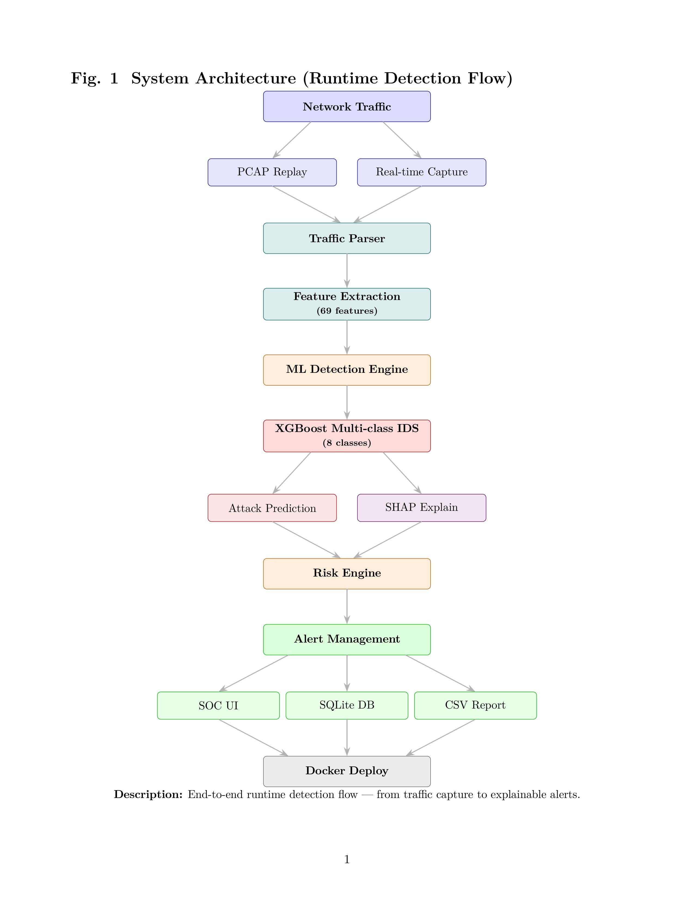
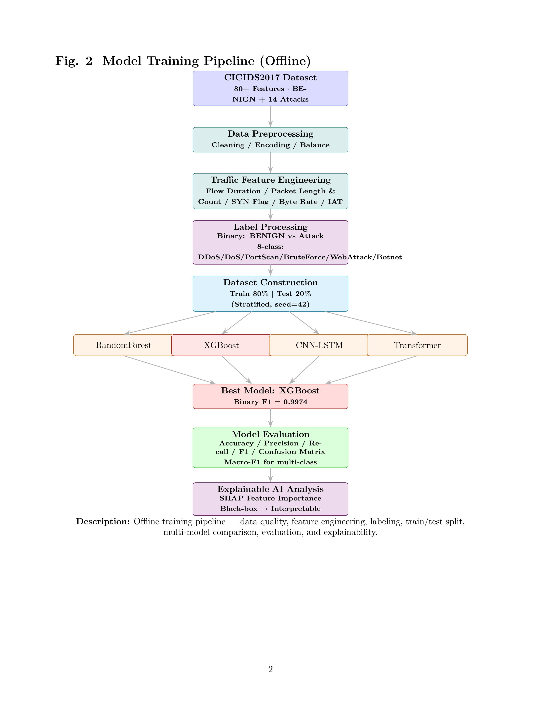

# 网络入侵检测与安全运营平台

**Explainable Real-time Network Intrusion Detection System**

> 从真实网络流量到可解释告警的端到端智能安全检测平台。
> 数据清洗 → 多模型对比 → XGBoost 最优模型 → 实时流量检测 → 告警生命周期管理 → SHAP 可解释 → Docker 一键部署。

---

## 目录

1. [项目背景](#1-项目背景)
2. [系统架构](#2-系统架构)
3. [技术路线](#3-技术路线)
4. [数据集介绍](#4-数据集介绍)
5. [模型训练](#5-模型训练)
6. [实时检测流程](#6-实时检测流程)
7. [告警管理设计](#7-告警管理设计)
8. [SHAP 可解释机制](#8-shap-可解释机制)
9. [Docker 部署](#9-docker-部署)
10. [实验与结果](#10-实验与结果)

---

## 1. 项目背景

传统入侵检测(IDS)依赖人工编写的特征规则,存在**规则覆盖不全、误报率高、难以应对未知攻击**等问题。基于机器学习的检测模型虽然提升了识别能力,但**"黑盒"决策不可解释**,安全分析师无法理解模型为何告警,也难以信任和处置。

本项目构建一个**从流量采集到可解释告警的端到端平台**:

- **机器学习驱动**:基于 CICIDS2017 公开数据集训练多分类检测模型,识别 8 类网络威胁;
- **可解释检测**:集成 SHAP 特征归因,让每次告警都给出"模型为什么判定为 DDoS"的可读依据;
- **安全运营 (SOC)**:将检测结果组织为带风险等级、告警状态、处置建议的控制台,支持告警生命周期管理与历史溯源;
- **工程化交付**:SQLite 持久化 + Docker 一键部署,具备真实产品的工程形态。

一句话:不只是"能检测攻击的模型",而是"**能解释、能运营、能部署**的智能安全平台"。

---

## 2. 系统架构



**四层结构**:

| 层次 | 组件 | 技术 |
|---|---|---|
| 采集层 | 实时抓包 / pcap 回放 / 模拟流量 | Scapy、CICFlowMeter 特征口径 |
| 检测层 | XGBoost 多分类 + 行为启发式 | XGBoost、规则引擎 |
| 解释层 | SHAP 特征归因 | shap.TreeExplainer |
| 运营层 | SOC 控制台 + 持久化 | FastAPI、Vue3、ECharts、SQLite |

---

## 3. 技术路线

```
数据 → 清洗 → 特征 → 建模 → 评估 → 部署 → 解释 → 运营
```

| 环节 | 技术选型 | 说明 |
|---|---|---|
| 数据 | CICIDS2017 | 国际标准入侵检测数据集,8 个工作日流量文件 |
| 数据处理 | pandas / numpy | NaN/Inf 处理、跨文件列一致性、重复清洗、标签分组 |
| 特征 | 69 维 CICIDS 流特征 | 包长/时间间隔/标志位/速率/子流等统计量 |
| 机器学习 | scikit-learn / XGBoost | RandomForest、XGBoost 基线 |
| 深度学习 | PyTorch + CUDA | CNN-LSTM、Transformer 对比 |
| 推理服务 | FastAPI + SSE | 模型推理 API + 实时事件流 |
| 前端 | Vue3 + ECharts | 实时监控面板(SOC 控制台) |
| 可解释 | SHAP | TreeExplainer 特征归因 |
| 存储 | SQLite | 告警持久化、状态流转、SHAP 缓存 |
| 部署 | Docker / docker-compose | 一键启动 |

---

## 4. 数据集介绍

[CICIDS2017](https://www.unb.ca/cic/datasets/ids-2017.html) 是加拿大 CIC 发布的入侵检测基准数据集,包含**正常流量与 14 种攻击流量**:

| 类别 | 说明 |
|---|---|
| 良性流量 | BENIGN(HTTP/HTTPS/FTP/SSH 等日常业务) |
| DoS / DDoS | 拒绝服务攻击(Hulk、GoldenEye、slowloris、Slowhttptest、Heartbleed、DDoS) |
| 侦察攻击 | PortScan(端口扫描) |
| 暴力破解 | BruteForce(FTP-Patator、SSH-Patator) |
| Web 攻击 | WebAttack(Brute Force、XSS、Sql Injection) |
| 僵尸网络 | Botnet |
| 内网渗透 | Infiltration |

**原始规模**:8 个工作日 CSV 文件,约 **283 万条流**,每条流 **78 个特征 + 1 个标签列**。

### 数据清洗(处理 3 个真实数据坑)

| 问题 | 处理 |
|---|---|
| 列名带空格/大小写不一致(`' Label'` 等) | 列名标准化(去空格、转小写) |
| `Infinity` 字符串混入特征 | `Inf`/`-Inf` → NaN → 删行 |
| 跨文件常量列集合不一致(如 Infiltration 文件保留 URG/CWE 标志位而其他文件删掉) | 常量列改在**合并后全局判定**,消除 228 万个潜伏 NaN |
| 标签中 Web Attack 横线字符损坏为 `U+FFFD` | 归一化匹配,15 类 → 8 大类 |

**清洗结果**:

| 指标 | 数值 |
|---|---|
| 原始行数 | 2,830,743 |
| 去重后 | 2,520,798 |
| BENIGN | 2,095,057(83.1%) |
| Attack | 425,741(16.9%) |
| 特征数 | 69 |

---

## 5. 模型训练

**模型训练流程图**(回答"模型怎么来的、为什么可信";LaTeX 版见 [`diagrams.tex`](./diagrams.tex)):



### 5.1 数据划分

分层抽样 30 万条(按类别比例,`random_state=42`),80/20 切分训练/测试,**四个模型在同一测试集上对比**。

### 5.2 二分类(BENIGN vs Attack)

| 模型 | 框架 | 说明 |
|---|---|---|
| RandomForest | scikit-learn | 200 棵树,`class_weight='balanced_subsample'` |
| XGBoost | XGBoost | 300 棵树,hist 直方图加速 |
| CNN-LSTM | PyTorch | Conv1d → 双向 LSTM,69 特征补零成 128 序列 |
| Transformer | PyTorch | 2 层编码器 + 位置编码 |

### 5.3 多分类(8 类威胁)

在二分类基础上扩展为 8 类(`BENIGN / DDoS / PortScan / Botnet / BruteForce / WebAttack / DoS / Infiltration`),DL 使用**逆频类别权重**缓解严重类别失衡。

> 训练脚本:`src/train_ml.py`、`src/train_dl.py`、`src/train_ml_multi.py`、`src/train_dl_multi.py`

---

## 6. 实时检测流程

```
真实流量 → Scapy 实时抓包 / pcap 回放 / 模拟器
       → 按五元组聚合为"流"
       → 增量计算 69 维 CICIDS 特征
       → XGBoost 多分类:攻击类型 + 置信度
       → 行为启发式补足(端口扫描 / SYN 洪泛)
       → 生成告警(类型/风险/源目标IP/证据/建议)
       → SSE 推送到 Web 控制台 + 写入 SQLite
```

**检测引擎 = 模型 + 行为启发式**(互补):

| 机制 | 检测对象 | 说明 |
|---|---|---|
| XGBoost 多分类 | CICIDS 分布内的 8 类威胁 | 基于 69 维流特征 |
| 端口扫描启发式 | 同源探测 >15 个目标端口 | 单包扫描流无法被 69 维特征识别 |
| SYN 洪泛启发式 | 同源对同目标聚合 >100 SYN 无回包 | 轮换源端口的洪泛需跨流聚合 |

**产品语义**:正常流量不产生告警;告警携带完整上下文(来源 IP、目标 IP:端口、协议)。

---

## 7. 告警管理设计

以"安全分析师处置告警"为核心,实现了类 SOC 控制台:

### 7.1 风险分级

| 风险 | 攻击类型 | 处置优先级 |
|---|---|---|
| HIGH | DDoS / DoS / Botnet / Infiltration | 立即响应 |
| MEDIUM | PortScan / BruteForce / WebAttack | 尽快排查 |
| LOW | BENIGN | 关注 |

### 7.2 告警生命周期管理

每条告警带状态字段,支持从**发现到关闭**的闭环处理:

```
NEW(新告警) → CONFIRMED(已确认) / IGNORED(已忽略) → CLOSED(已关闭)
```

### 7.3 控制台能力

- **风险筛选/排序**:按 HIGH/MEDIUM/LOW 筛选,支持"风险优先"与"时间最新"排序
- **攻击类型 / 时间范围筛选**:秒级过滤
- **告警详情**:事件 ID、源/目标 IP:端口、置信度、检测依据、处置建议、SHAP 解释
- **CSV 导出**:一键导出 `time,attack,risk_level,src_ip,dst_ip,dst_port,confidence,status`
- **SQLite 持久化**:所有告警自动落库,页面加载读取历史,重启不丢

---

## 8. SHAP 可解释机制

解决"黑盒模型不可信"问题,让每次告警都能回答:**模型为什么判定为 DDoS?**

### 8.1 原理

使用 `shap.TreeExplainer` 对 XGBoost 树模型做特征归因——沿树分裂路径计算每个特征对预测的边际贡献,把"模型的决策"分解为"每个特征的推动量"。

### 8.2 呈现

告警详情页展示 **Top 5 影响特征**及其**影响占比**(SHAP 贡献幅度的归一化百分比):

```
Flow Packets/s          +35%   ████████████░░░  (推动判定)
SYN Flag Count          +28%   ██████████░░░░░  (推动判定)
Flow Duration           +15%   █████░░░░░░░░░░  (推动判定)
```

蓝色 = 推动判定为该攻击,红色 = 抑制。

### 8.3 工程要点

- 多分类 XGBoost 的 `base_score` 序列化为数组字符串导致 SHAP 解析失败 → 通过 monkeypatch 解码器解决;
- SHAP 结果缓存到 SQLite,历史告警重看详情无需重算。

---

## 9. Docker 部署

```bash
cd 项目根目录
docker compose up -d --build
# 访问 http://localhost:8000
```

| 组件 | 实现 |
|---|---|
| frontend | Vue 面板,由 backend 容器托管 |
| backend | FastAPI(Dockerfile,端口 8000) |
| model | `models/ids_xgb_multi.json` 打包进镜像 |
| database | SQLite 文件库 + 持久卷 `/data/alerts.db` |

环境变量:`MODELS_DIR`(模型目录)、`DB_PATH`(数据库路径),均已实测覆盖生效。

---

## 10. 实验与结果

### 10.1 二分类(BENIGN vs Attack,同一测试集 6 万条)

| 模型 | Accuracy | Precision | Recall | F1 |
|---|---|---|---|---|
| RandomForest | 0.9983 | 0.9973 | 0.9925 | **0.9949** |
| **XGBoost** | **0.9991** | **0.9973** | **0.9975** | **0.9974** |
| CNN-LSTM | 0.9633 | 0.8285 | 0.9872 | 0.9009 |
| Transformer | 0.9771 | 0.8915 | 0.9844 | 0.9357 |

### 10.2 多分类(8 类威胁)

| 模型 | Accuracy | Macro-F1 | Weighted-F1 |
|---|---|---|---|
| RandomForest | 0.9971 | 0.7987 | 0.9976 |
| **XGBoost** | **0.9989** | **0.8461** | **0.9989** |
| CNN-LSTM | 0.7714 | 0.4042 | 0.8349 |
| Transformer | 0.8629 | 0.4630 | 0.9000 |

### 10.3 多分类各类别表现(XGBoost)

| 类别 | Precision | Recall | F1 | 样本 |
|---|---|---|---|---|
| BENIGN | 0.9998 | 0.9989 | 0.9994 | 49,867 |
| DoS | 0.9976 | 0.9996 | 0.9986 | 4,612 |
| DDoS | 0.9993 | 0.9987 | 0.9990 | 3,047 |
| PortScan | 0.9908 | 0.9991 | 0.9949 | 2,158 |
| BruteForce | 0.9909 | 1.0000 | 0.9954 | 218 |
| WebAttack | 1.0000 | 1.0000 | 1.0000 | 51 |
| Botnet | 0.6719 | 0.9348 | 0.7818 | 46 |
| Infiltration | 0.0000 | 0.0000 | 0.0000 | 1 |

### 10.4 关键结论

1. **当前基线中树模型显著优于深度学习**:二分类 F1 0.9974(XGB) vs 0.9357(Transformer);多分类 Weighted-F1 0.9989 vs 0.9000。
   **解释边界**:CICIDS2017 是"表格式手工特征",树模型天然匹配;DL 把 69 维特征排成"伪序列"存在结构错配。原始 DL 指标来自 10 epoch 探索性基线,训练脚本已升级为 50 epoch 上限、验证集早停和最佳权重回滚,重跑后应更新指标。
   → 详见 [`reports/experiment_analysis.md`](./reports/experiment_analysis.md)(完整实验分析)

2. **类别失衡是主要难点**:`Infiltration` 全库仅 36 条,抽样后训练集 ~4 条 → 任何模型都难以学习;`Botnet` 通过逆频权重可拉到 F1 0.78。

3. **可解释性价值**:SHAP 让 XGBoost 的"黑盒"决策可读,同时保持高性能——**高精度 + 可解释**兼顾,是相比纯 DL 方案的核心优势。

4. **行为启发式补足模型盲区**:纯单向 SYN 洪泛、端口扫描不在 CICIDS 训练分布内,靠跨流行为规则识别,形成"模型 + 规则"互补。

---

## 快速开始

```bash
# 1. 离线实验(数据清洗 → 特征分析 → 训练)
D:\miniconda3\condabin\conda.bat activate ids
python src/data_clean.py
python src/feature_analysis.py
python src/train_ml_multi.py

# 2. 实时检测服务
cd detector
python -m uvicorn api_server:app --host 127.0.0.1 --port 8000
# 浏览器打开 http://127.0.0.1:8000
```

### 真实流量抓包

Windows 下需要先安装 Npcap,并以管理员权限启动上面的检测服务。打开前端后,在顶部控制区点击 **开始实时抓包**;网卡输入框可留空使用默认网卡,也可以从 `/capture/interfaces` 返回的列表中选择指定网卡。

实时抓到的包会被聚合为 CICIDS 风格流特征,再送入 XGBoost 模型和端口扫描/SYN 洪泛行为规则。页面会显示实时包数、已结算流数、告警数;异常真实流量会进入告警表并支持详情查看和 SHAP 解释。

> 检测服务详细文档见 [`detector/README.md`](./detector/README.md)

---

## 项目结构

```
project1/
├── data/MachineLearningCVE/   # CICIDS2017 原始 8 个 CSV
├── processed/                 # 清洗后 parquet + 清洗统计
├── src/                       # 离线实验:清洗/特征分析/ML/DL 训练
├── models/                    # 训练好的模型(最优:ids_xgb_multi.json)
├── detector/                  # 实时检测服务(FastAPI + SOC 控制台)
│   ├── inference.py           # 模型推理核心
│   ├── flow_extractor.py      # Scapy 流特征提取 + 行为启发式
│   ├── evidence.py            # 风险分级/检测依据/处置建议
│   ├── explain.py             # SHAP 特征归因
│   ├── db.py                  # SQLite 告警持久化
│   ├── api_server.py          # FastAPI 服务
│   ├── static/index.html      # Vue3 + ECharts SOC 控制台
│   └── arch.svg               # 系统架构图
├── reports/                   # 实验报告与图表
├── diagrams.tex               # 两张流程图 (LaTeX/TikZ)
├── diagram_architecture.jpg   # 系统架构图(渲染版,README 展示)
├── diagram_training.jpg       # 模型训练流程图(渲染版,README 展示)
├── Dockerfile                 # 后端镜像
└── docker-compose.yml         # 一键部署
```
