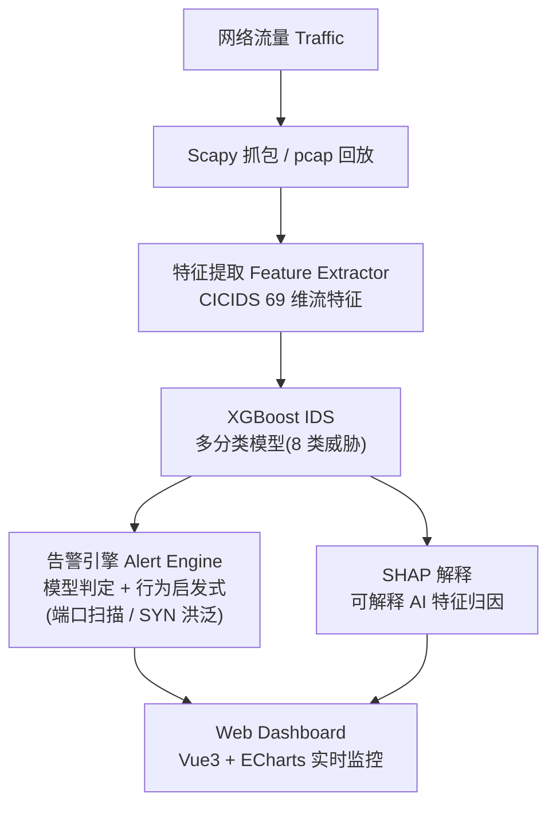
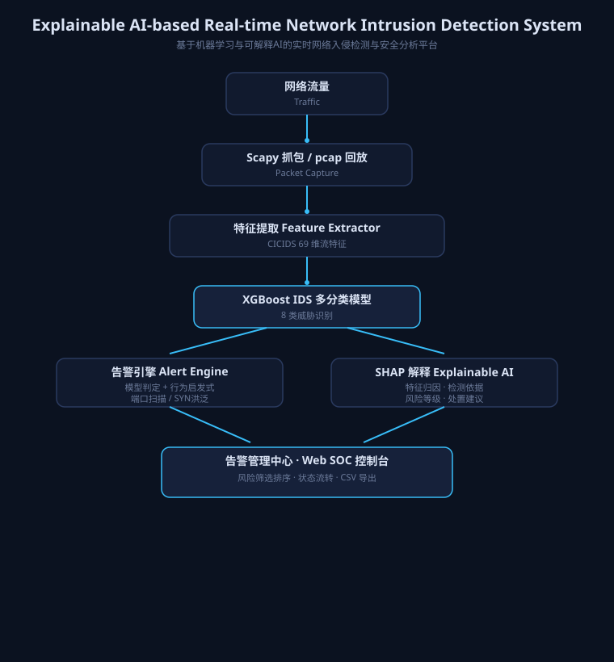

# 可解释AI实时网络入侵检测与安全分析平台

**Explainable AI-based Real-time Network Intrusion Detection System**

从真实网络流量中提取 CICIDS 流特征,经 **XGBoost 多分类模型**识别 8 类威胁,
结合**行为启发式**与 **SHAP 可解释特征归因**,输出带风险等级、检测依据与处置建议的
安全告警,由 Web 面板实时呈现——把黑盒模型变成可解释、可运营的安全产品。

## 系统架构





## 文件结构

```
detector/
├── inference.py        模型推理核心(特征名归一化 + 预测)
├── api_server.py       FastAPI 服务(POST /predict, GET /events SSE, 模拟控制)
├── simulate.py         模拟流量事件源(从真实数据抽样,无需抓包)
├── flow_extractor.py   可选:Scapy 实时抓包 → CICIDS 特征(需 Npcap)
├── static/index.html   Vue 3 + ECharts 监控面板
└── requirements.txt
```

## 安装

```bash
D:\miniconda3\condabin\conda.bat activate ids
cd detector
pip install -r requirements.txt
```

可选:实时抓包需要额外安装 **Npcap**(https://npcap.com) 并以管理员运行。

## 运行

```bash
cd detector
python -m uvicorn api_server:app --host 127.0.0.1 --port 8000
```

浏览器打开 **http://127.0.0.1:8000/** 查看监控面板。

## Docker 一键部署

前置:Docker Desktop(Windows)或 Docker Engine(Linux)。

```bash
cd 项目根目录
docker compose up -d --build
```

- 访问 **http://localhost:8000/**(前端面板 + 后端 API + 模型)
- 告警数据持久化到命名卷 `ids-alert-data`,重启/重建容器不丢失

四个组件:

| 组件 | 实现 |
|---|---|
| frontend | Vue 面板,由 backend 容器托管(`detector/static`) |
| backend | FastAPI 服务(`Dockerfile`,端口 8000) |
| model | `models/ids_xgb_multi.json` 打包进镜像 |
| database | SQLite 文件库 + 持久卷(`/data/alerts.db`) |

环境变量(可在 docker-compose 中覆盖):

- `MODELS_DIR` — 模型目录,默认 `/app/models`
- `DB_PATH` — SQLite 路径,默认 `/data/alerts.db`

停止:`docker compose down`(加 `-v` 会同时删除数据卷)。

面板打开后,点击 **"▶ 开始模拟"** 即可看到实时检测事件
(事件源从清洗后的真实 CICIDS2017 数据按类别抽样,走真实模型推理)。

## API

### POST /predict —— 模型推理

输入任意 CICIDS 特征字典(键名兼容原始列名或清洗后小写名,缺失特征补 0):

```bash
curl -X POST http://127.0.0.1:8000/predict \
  -H "Content-Type: application/json" \
  -d '{
    "Flow Duration": 900000,
    "Total Fwd Packets": 100,
    "Total Backward Packets": 80,
    "Total Length of Fwd Packets": 12000,
    "Total Length of Bwd Packets": 9000,
    "Fwd Packet Length Mean": 120,
    "Bwd Packet Length Mean": 112,
    "Flow Bytes/s": 20000,
    "Flow Packets/s": 200,
    "Flow IAT Mean": 5000,
    "SYN Flag Count": 2,
    "ACK Flag Count": 150
  }'
```

返回:

```json
{
  "attack": "DDoS",
  "confidence": 0.9989,
  "probabilities": {
    "BENIGN": 0.0, "DDoS": 0.9989, "PortScan": 0.0,
    "Botnet": 0.0, "BruteForce": 0.0, "WebAttack": 0.0,
    "DoS": 0.0, "Infiltration": 0.0
  }
}
```

预测结果会自动推送到面板实时事件流。

### 其他端点

| 端点 | 说明 |
|---|---|
| `GET /health` | 健康检查 |
| `GET /models` | 模型类别 / 特征列表 |
| `GET /events` | SSE 实时事件流(事件含风险等级/证据/建议/源目标IP) |
| `GET /events/history` | 最近 100 条事件 |
| `POST /simulate/start` | 启动模拟 `{"rate": 1.0}`(真实数据抽样,无需抓包) |
| `POST /simulate/stop` | 停止模拟 |
| `POST /explain` | SHAP 特征归因(解释模型判定,需 `pip install shap`) |
| `GET /explain/{event_id}` | 按事件 ID 获取 SHAP 解释 |
| `GET /capture/interfaces` | 列出 Scapy 可见网卡,供实时抓包选择 |
| `GET /capture/status` | 查看实时抓包状态、包数、流数、告警数 |
| `POST /capture/replay` | 离线 pcap 回放 `{"pcap": "path"}`(纯 Python,无需 Npcap) |
| `POST /capture/start` | Scapy 实时抓包 `{"iface": "Ethernet", "idle_timeout": 15}`(需 Npcap+管理员) |
| `POST /capture/stop` | 停止抓包 |

## 演示:离线 pcap 回放(无需 Npcap)

项目自带合成样本 `detector/samples/test_flows.pcap`(正常流量 + SYN 洪泛 + 端口扫描):

```bash
python make_sample_pcap.py                                   # 重新生成样本
curl -X POST http://127.0.0.1:8000/capture/replay \
  -H "Content-Type: application/json" \
  -d '{"pcap": "E:/project1/detector/samples/test_flows.pcap"}'
```

面板会实时出现 **DoS(HIGH)** 与 **PortScan(MEDIUM)** 告警,点击行可查看
检测依据 / 处置建议 / SHAP 特征解释。

## 告警详情

点击面板事件行弹出详情:攻击类型、风险等级(HIGH/MEDIUM/LOW)、攻击源、
目标 IP:端口、置信度、**检测依据**(规则化证据)、**处置建议**、
**SHAP 特征解释**(影响最大的特征及贡献方向,需安装 shap)。

## 告警管理(SOC 控制台)

- **风险筛选/排序**:按 HIGH / MEDIUM / LOW 筛选,支持"风险优先"与"时间最新"排序
- **告警生命周期管理**:每条告警带状态 `NEW → CONFIRMED / IGNORED → CLOSED`,
  支持从发现到确认/处置/关闭的闭环处理(`POST /events/{id}/status`)
- **CSV 导出**:一键导出告警 `time,attack,risk_level,src_ip,dst_ip,dst_port,confidence,status`
  (`GET /events/export`,Excel 打开中文不乱码)

## 检测逻辑(模型 + 行为启发式互补)

1. **XGBoost 多分类模型**:识别 CICIDS2017 分布内的 8 类攻击(基于 69 维流特征);
2. **端口扫描启发式**:同一源 IP 时间窗内探测 >15 个目标端口;
3. **SYN 洪泛启发式**:同一源对同一目标聚合 >100 个 SYN 且无回包(轮换源端口);
4. 正常流量不产生告警(产品语义)。

## 实时抓包:分析本机真实流量

需要可重复的限时观测、逐流记录和标签指标时，使用新增的 `evaluate_traffic.py`。详见[真实流量评估指南](../docs/real_traffic_evaluation.md)和[首轮实测记录](../reports/real_traffic_observation.md)。该工具和 API 共用 `detection.py` 检测引擎。

前置条件:

- 已安装 Python 依赖: `pip install -r requirements.txt`
- Windows 需要安装 Npcap,并勾选 WinPcap API-compatible mode
- 以管理员权限启动终端,否则可能没有网卡抓包权限

启动服务后打开面板,在顶部控制区点击 **开始实时抓包**。网卡输入框可以留空使用默认网卡,也可以从候选列表中选择 Scapy 识别到的网卡名称。页面会显示实时包数、已结算流数和告警数;检测出的真实异常流量会进入同一张告警表。

也可以用 API 方式启动:

```bash
curl http://127.0.0.1:8000/capture/interfaces

curl -X POST http://127.0.0.1:8000/capture/start \
  -H "Content-Type: application/json" \
  -d '{"iface": "", "idle_timeout": 15}'

curl http://127.0.0.1:8000/capture/status

curl -X POST http://127.0.0.1:8000/capture/stop
```

`idle_timeout` 表示一条流多久没有新包后结算并送入模型。默认 15 秒,比生产环境更短,适合课堂/答辩演示时快速看到分析结果。

### 独立脚本方式

```python
# 独立脚本方式
from flow_extractor import sniff_loop
from inference import predict

def on_flow(features, meta):
    r = predict(features)
    print(r["attack"], r["confidence"], meta["src_ip"], "->", meta["dst_ip"])

sniff_loop(on_flow=on_flow)   # 需要 scapy + Npcap + 管理员权限
```

注意事项:本项目的 `flow_extractor.py` 已统一时间统计单位为微秒,但 header_length、
subflow、active/idle 等仍有近似,与官方 CICFlowMeter 尚未完成逐列对齐。
真实流量准确率需要独立标签评估,不能仅凭离线成绩推断。
采用其他提取器时也需要核对特征定义、单位、方向和顺序。
